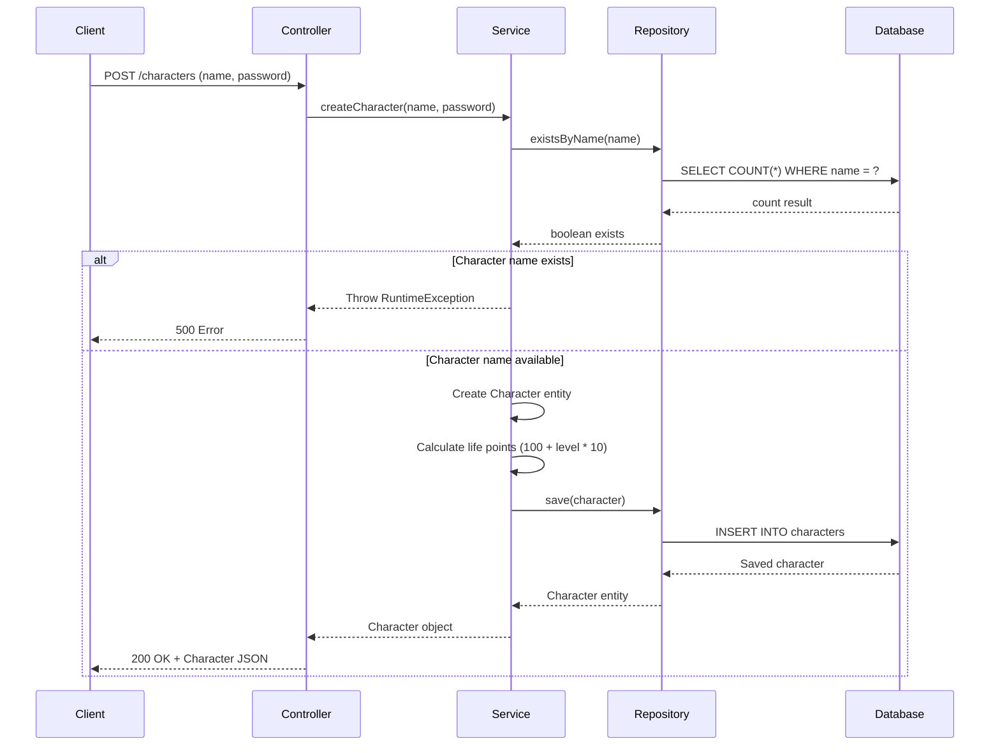
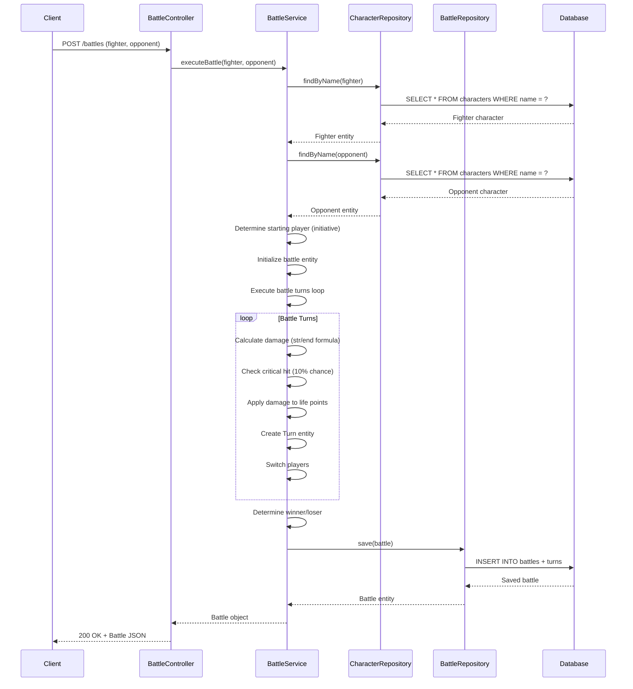
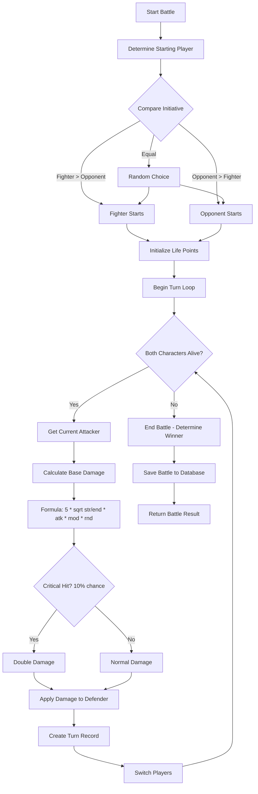

# Creeds Game API

A Spring Boot REST API for managing characters and battles in the Creeds game. This API provides endpoints for character creation, authentication, and turn-based battle execution.

## Table of Contents

- [Overview](#overview)
- [Architecture](#architecture)
- [Technology Stack](#technology-stack)
- [API Endpoints](#api-endpoints)
- [Flow Diagram](#flow-diagram)
- [Usage Examples](#usage-examples)
- [Database Schema](#database-schema)
- [Swagger Documentation](#swagger-documentation)
- [Getting Started](#getting-started)
- [Testing](#testing)
- [Wiki](#wiki)

---

## Overview

The Creeds Game API is a turn-based battle system where players can:
- Create and manage game characters
- Authenticate characters
- Execute battles between characters
- View battle history and results

### Key Features

- **Character Management**: Create, retrieve, and authenticate characters
- **Battle System**: Turn-based combat with damage calculation, critical hits, and initiative-based turn order
- **RESTful API**: Clean REST endpoints following best practices
- **Swagger Documentation**: Interactive API documentation
- **Database Integration**: H2 in-memory database for development/testing
- **Comprehensive Testing**: Unit tests for services

---

## Architecture

The API follows a layered architecture:

```
┌─────────────────────────────────────┐
│         REST Controllers            │
│  (CharacterController,              │
│   BattleController)                 │
└──────────────┬──────────────────────┘
               │
┌──────────────▼──────────────────────┐
│         Service Layer               │
│  (CharacterService,                 │
│   BattleService)                    │
└──────────────┬──────────────────────┘
               │
┌──────────────▼──────────────────────┐
│      Repository Layer               │
│  (CharacterRepository,              │
│   BattleRepository)                 │
└──────────────┬──────────────────────┘
               │
┌──────────────▼──────────────────────┐
│         Database (H2)               │
└─────────────────────────────────────┘
```

### Components

- **Controllers**: Handle HTTP requests and responses
- **Services**: Contain business logic
- **Repositories**: Data access layer using Spring Data JPA
- **Models**: Entity classes representing database tables

---

## Technology Stack

- **Framework**: Spring Boot 3.2.3
- **Language**: Java 17
- **Database**: H2 (in-memory) / MySQL (production-ready)
- **ORM**: Spring Data JPA / Hibernate
- **API Documentation**: Swagger/OpenAPI 3 (SpringDoc)
- **Build Tool**: Maven
- **Testing**: JUnit 5, Mockito
- **Utilities**: Lombok

---

## API Endpoints

### Base URL
```
http://localhost:8080/api/v1
```

### Character Management

#### Create Character
```http
POST /characters
Content-Type: application/x-www-form-urlencoded

Parameters:
- name (required): Character name (alphanumeric, max 30 chars)
- password (required): Character password (max 50 chars)
```

#### Get Character by Name
```http
GET /characters/{name}
```

#### Get All Characters
```http
GET /characters
```

#### Login Character
```http
POST /characters/login
Content-Type: application/x-www-form-urlencoded

Parameters:
- name (required): Character name
- password (required): Character password
```

### Battle Management

#### Execute Battle
```http
POST /battles
Content-Type: application/x-www-form-urlencoded

Parameters:
- fighter (required): Name of the fighter character
- opponent (required): Name of the opponent character
```

---

## Flow Diagram

### Character Creation Flow



### Battle Execution Flow



### Battle Turn Logic Flow



---

## Usage Examples

### Example 1: Create Two Characters and Execute a Battle

#### Step 1: Create First Character (Warrior)

**Request:**
```bash
curl -X POST "http://localhost:8080/api/v1/characters" \
  -H "Content-Type: application/x-www-form-urlencoded" \
  -d "name=warrior&password=123456"
```

**Response:**
```json
{
  "id": 1,
  "name": "warrior",
  "password": "123456",
  "level": 1,
  "strength": 10,
  "endurance": 10,
  "initiative": 10,
  "life": 110
}
```

#### Step 2: Create Second Character (Mage)

**Request:**
```bash
curl -X POST "http://localhost:8080/api/v1/characters" \
  -H "Content-Type: application/x-www-form-urlencoded" \
  -d "name=mage&password=123456"
```

**Response:**
```json
{
  "id": 2,
  "name": "mage",
  "password": "123456",
  "level": 1,
  "strength": 10,
  "endurance": 10,
  "initiative": 10,
  "life": 110
}
```

#### Step 3: Get Character Information

**Request:**
```bash
curl -X GET "http://localhost:8080/api/v1/characters/warrior"
```

**Response:**
```json
{
  "id": 1,
  "name": "warrior",
  "password": "123456",
  "level": 1,
  "strength": 10,
  "endurance": 10,
  "initiative": 10,
  "life": 110
}
```

#### Step 4: Execute Battle

**Request:**
```bash
curl -X POST "http://localhost:8080/api/v1/battles" \
  -H "Content-Type: application/x-www-form-urlencoded" \
  -d "fighter=warrior&opponent=mage"
```

**Response:**
```json
{
  "battleId": "warrior:1703123456789",
  "fighter": {
    "id": 1,
    "name": "warrior",
    "level": 1,
    "strength": 10,
    "endurance": 10,
    "initiative": 10,
    "life": 110
  },
  "opponent": {
    "id": 2,
    "name": "mage",
    "level": 1,
    "strength": 10,
    "endurance": 10,
    "initiative": 10,
    "life": 110
  },
  "startingPlayer": "warrior",
  "winner": "warrior",
  "loser": "mage",
  "fighterLife": 45,
  "opponentLife": 0,
  "creationDate": "2024-01-15T10:30:45",
  "turns": [
    {
      "id": 1,
      "turnNumber": 1,
      "executor": "warrior",
      "receiver": "mage",
      "action": "HIT",
      "damage": 5
    },
    {
      "id": 2,
      "turnNumber": 2,
      "executor": "mage",
      "receiver": "warrior",
      "action": "CRITICAL HIT",
      "damage": 10
    },
    {
      "id": 3,
      "turnNumber": 3,
      "executor": "warrior",
      "receiver": "mage",
      "action": "HIT",
      "damage": 5
    }
    // ... more turns until one character's life reaches 0
  ]
}
```

### Example 2: Using Postman

1. **Create Character**
   - Method: `POST`
   - URL: `http://localhost:8080/api/v1/characters`
   - Body (x-www-form-urlencoded):
     - `name`: `warrior`
     - `password`: `123456`

2. **Login Character**
   - Method: `POST`
   - URL: `http://localhost:8080/api/v1/characters/login`
   - Body (x-www-form-urlencoded):
     - `name`: `warrior`
     - `password`: `123456`
   - Response: `true` or `false`

3. **Get All Characters**
   - Method: `GET`
   - URL: `http://localhost:8080/api/v1/characters`

4. **Execute Battle**
   - Method: `POST`
   - URL: `http://localhost:8080/api/v1/battles`
   - Body (x-www-form-urlencoded):
     - `fighter`: `warrior`
     - `opponent`: `mage`

### Example 3: Using JavaScript (Fetch API)

```javascript
// Create a character
async function createCharacter(name, password) {
  const formData = new URLSearchParams();
  formData.append('name', name);
  formData.append('password', password);
  
  const response = await fetch('http://localhost:8080/api/v1/characters', {
    method: 'POST',
    headers: {
      'Content-Type': 'application/x-www-form-urlencoded',
    },
    body: formData
  });
  
  return await response.json();
}

// Execute a battle
async function executeBattle(fighter, opponent) {
  const formData = new URLSearchParams();
  formData.append('fighter', fighter);
  formData.append('opponent', opponent);
  
  const response = await fetch('http://localhost:8080/api/v1/battles', {
    method: 'POST',
    headers: {
      'Content-Type': 'application/x-www-form-urlencoded',
    },
    body: formData
  });
  
  return await response.json();
}

// Usage
const warrior = await createCharacter('warrior', '123456');
const mage = await createCharacter('mage', '123456');
const battle = await executeBattle('warrior', 'mage');
console.log('Battle winner:', battle.winner);
```

---

## Database Schema

### Characters Table

| Column      | Type    | Constraints           | Description                          |
|-------------|---------|-----------------------|--------------------------------------|
| id          | BIGINT  | PRIMARY KEY, AUTO_INCREMENT | Unique identifier                |
| name        | VARCHAR(30) | UNIQUE, NOT NULL | Character name (alphanumeric)     |
| password    | VARCHAR(50) | NOT NULL        | Character password                |
| level       | INT     | NOT NULL, DEFAULT 1   | Character level                   |
| strength    | INT     | NOT NULL, DEFAULT 10  | Attack strength                   |
| endurance   | INT     | NOT NULL, DEFAULT 10  | Defense/endurance                  |
| initiative  | INT     | NOT NULL, DEFAULT 10  | Turn order priority               |
| life        | INT     | NOT NULL              | Life points (calculated: 100 + level * 10) |

### Battles Table

| Column         | Type         | Constraints           | Description                          |
|----------------|--------------|-----------------------|--------------------------------------|
| battle_id      | VARCHAR      | PRIMARY KEY           | Unique battle identifier             |
| fighter_id     | BIGINT       | FOREIGN KEY, NOT NULL | Reference to fighter character      |
| opponent_id    | BIGINT       | FOREIGN KEY, NOT NULL | Reference to opponent character     |
| starting_player| VARCHAR      | NOT NULL              | Character who started the battle     |
| winner         | VARCHAR      | NOT NULL              | Winner character name                |
| loser          | VARCHAR      | NOT NULL              | Loser character name                 |
| fighter_life   | INT          | NOT NULL              | Fighter's remaining life             |
| opponent_life  | INT          | NOT NULL              | Opponent's remaining life            |
| creation_date  | TIMESTAMP    | NOT NULL              | Battle creation timestamp            |

### Turns Table

| Column      | Type    | Constraints           | Description                          |
|-------------|---------|-----------------------|--------------------------------------|
| id          | BIGINT  | PRIMARY KEY, AUTO_INCREMENT | Unique identifier                |
| battle_id   | VARCHAR | FOREIGN KEY, NOT NULL | Reference to battle                |
| turn_number | INT     | NOT NULL              | Turn sequence number                |
| executor    | VARCHAR | NOT NULL              | Character who executed the turn      |
| receiver    | VARCHAR | NOT NULL              | Character who received the damage    |
| action      | VARCHAR | NOT NULL              | Action type (HIT or CRITICAL HIT)   |
| damage      | INT     | NOT NULL              | Damage dealt in this turn            |

### Entity Relationships

```
Character (1) ────< (Many) Battle (as fighter)
Character (1) ────< (Many) Battle (as opponent)
Battle (1) ────< (Many) Turn
```

---

## Swagger Documentation

Swagger UI is automatically configured and available when the application is running.

### Access Swagger UI

```
http://localhost:8080/api/v1/swagger-ui.html
```

### Access OpenAPI JSON

```
http://localhost:8080/api/v1/api-docs
```

### Features

- **Interactive API Testing**: Test endpoints directly from the browser
- **Request/Response Examples**: See example requests and responses
- **Schema Documentation**: View data models and their properties
- **Try It Out**: Execute API calls with custom parameters

---

## Getting Started

### Prerequisites

- Java 17 or higher
- Maven 3.6+
- (Optional) MySQL for production deployment

### Installation

1. **Clone the repository**
   ```bash
   git clone https://github.com/CreedsGame/creeds_api.git
   cd creeds_api
   ```

2. **Checkout the Spring Boot branch**
   ```bash
   git checkout new-springboot
   ```

3. **Build the project**
   ```bash
   mvn clean install
   ```

4. **Run the application**
   ```bash
   mvn spring-boot:run
   ```

   Or run the JAR file:
   ```bash
   java -jar target/creeds-api-1.0.0.jar
   ```

5. **Verify the application is running**
   - API Base URL: `http://localhost:8080/api/v1`
   - Swagger UI: `http://localhost:8080/api/v1/swagger-ui.html`
   - H2 Console: `http://localhost:8080/api/v1/h2-console`

### Configuration

Edit `src/main/resources/application.yml` to configure:

- **Database**: Change from H2 to MySQL for production
- **Server Port**: Default is 8080
- **Context Path**: Default is `/api/v1`

Example MySQL configuration:
```yaml
spring:
  datasource:
    url: jdbc:mysql://localhost:3306/creeds_db
    username: your_username
    password: your_password
    driver-class-name: com.mysql.cj.jdbc.Driver
  jpa:
    hibernate:
      ddl-auto: update
    properties:
      hibernate:
        dialect: org.hibernate.dialect.MySQLDialect
```

---

## Testing

### Running Tests

```bash
mvn test
```

### Test Coverage

The project includes unit tests for:
- `CharacterService`: Character creation, retrieval, and authentication
- `BattleService`: Battle execution and turn management

### Manual Testing with H2 Console

1. Access H2 Console: `http://localhost:8080/api/v1/h2-console`
2. Connection Details:
   - JDBC URL: `jdbc:h2:mem:creeds_db`
   - Username: `sa`
   - Password: (leave empty)
3. Run SQL queries:
   ```sql
   -- View all characters
   SELECT * FROM characters;
   
   -- View all battles
   SELECT * FROM battles;
   
   -- View battle with turns
   SELECT b.*, t.turn_number, t.executor, t.receiver, t.action, t.damage
   FROM battles b
   LEFT JOIN turns t ON b.battle_id = t.battle_id
   ORDER BY b.creation_date DESC, t.turn_number;
   ```

---

## Wiki

### Battle Mechanics

#### Damage Calculation

Damage is calculated using the following formula:

```
damage = floor(5 * sqrt(str/end * atk) * mod * rnd)
```

Where:
- `str` = Attacker's strength
- `end` = Defender's endurance
- `atk` = Base attack value (1.0)
- `mod` = Base modifier (1.0)
- `rnd` = Random factor between 0.8 and 1.2

#### Critical Hits

- **Chance**: 10% (1 in 10 turns)
- **Effect**: Damage is doubled
- **Action Type**: Changes from "HIT" to "CRITICAL HIT"

#### Turn Order

Turn order is determined by comparing character initiative:
1. Character with higher initiative goes first
2. If initiative is equal, random selection
3. Players alternate turns until one character's life reaches 0

#### Life Points

Life points are calculated automatically:
```
life = 100 + (level * 10)
```

Example:
- Level 1: 110 life points
- Level 5: 150 life points
- Level 10: 200 life points

### Character Attributes

#### Strength
- Affects damage dealt to opponents
- Higher strength = more damage
- Default: 10

#### Endurance
- Affects damage received from opponents
- Higher endurance = less damage taken
- Default: 10

#### Initiative
- Determines turn order in battles
- Higher initiative = goes first
- Default: 10

#### Level
- Affects life points calculation
- Higher level = more life points
- Default: 1

### API Response Codes

| Code | Description                    |
|------|--------------------------------|
| 200  | Success                        |
| 400  | Bad Request (missing parameters) |
| 404  | Resource Not Found             |
| 500  | Internal Server Error          |

### Error Handling

The API throws `RuntimeException` for:
- Character name already exists
- Character not found
- Fighter/Opponent not found

In production, consider implementing:
- Custom exception classes
- Global exception handler
- Proper HTTP status codes
- Error response DTOs

### Security Considerations

⚠️ **Current Implementation**: Passwords are stored in plain text.

**Recommendations for Production**:
- Use password hashing (BCrypt, Argon2)
- Implement JWT authentication
- Add rate limiting
- Enable HTTPS
- Input validation and sanitization
- SQL injection prevention (already handled by JPA)

### Performance Considerations

- **Database**: H2 is suitable for development. Use MySQL/PostgreSQL for production.
- **Connection Pooling**: Spring Boot auto-configures HikariCP
- **Lazy Loading**: Battle-Turn relationship uses LAZY fetching
- **Caching**: Consider adding Redis for frequently accessed data

### Future Enhancements

Potential improvements:
- [ ] Character leveling system
- [ ] Equipment/items system
- [ ] Battle history pagination
- [ ] Character statistics (win/loss ratio)
- [ ] Real-time battle updates (WebSocket)
- [ ] Multiplayer battles
- [ ] Character classes/types
- [ ] Special abilities/skills
- [ ] Battle replays
- [ ] Leaderboards

### Troubleshooting

#### Application won't start
- Check Java version: `java -version` (should be 17+)
- Check port availability: Ensure port 8080 is not in use
- Check Maven: `mvn -version`

#### Database connection errors
- Verify H2 dependency in `pom.xml`
- Check `application.yml` configuration
- Clear Maven cache: `mvn clean`

#### Battle execution fails
- Ensure both characters exist before executing battle
- Check character names are spelled correctly
- Verify characters have valid attributes

#### Swagger UI not accessible
- Verify SpringDoc dependency in `pom.xml`
- Check context path configuration
- Access via: `http://localhost:8080/api/v1/swagger-ui.html`

---

## License

This project is licensed under the GPL License - see the `gpl.txt` file for details.

---

## Contributing

1. Fork the repository
2. Create a feature branch (`git checkout -b feature/amazing-feature`)
3. Commit your changes (`git commit -m 'Add some amazing feature'`)
4. Push to the branch (`git push origin feature/amazing-feature`)
5. Open a Pull Request

---

## Contact

For questions or support, please open an issue on GitHub.

---

**Version**: 1.0.0  
**Last Updated**: 2024-01-15
