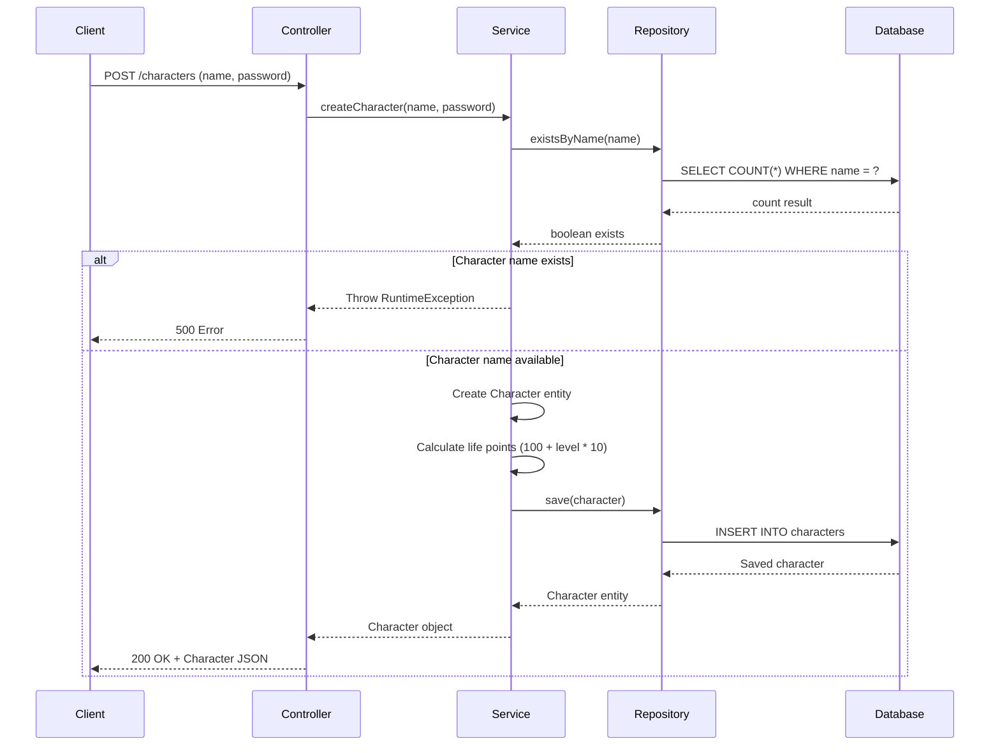
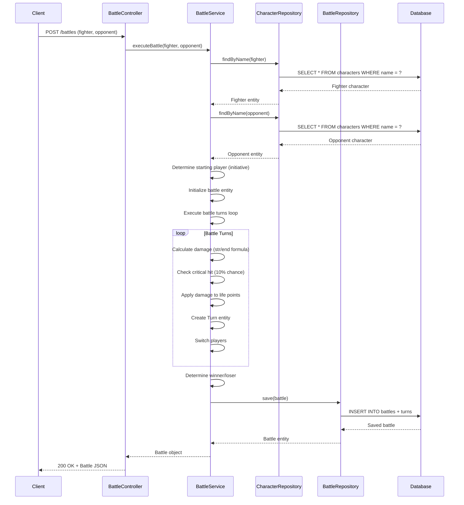
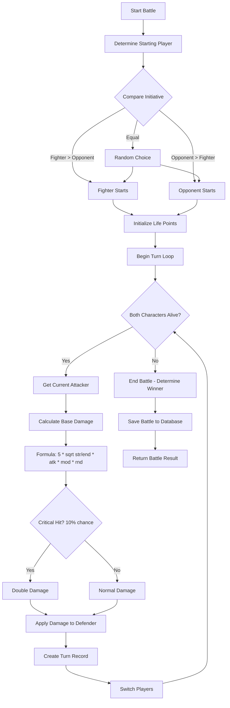
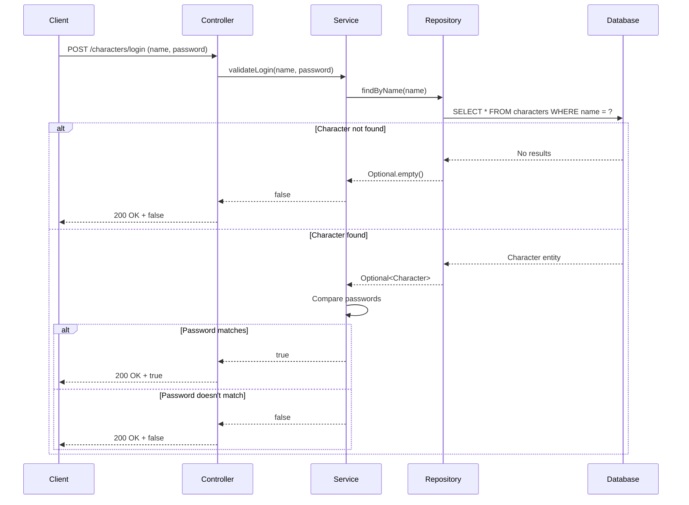
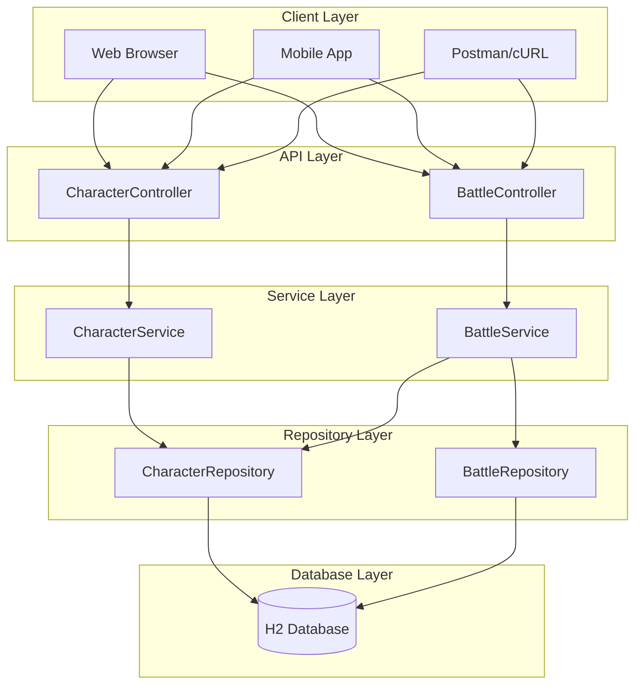
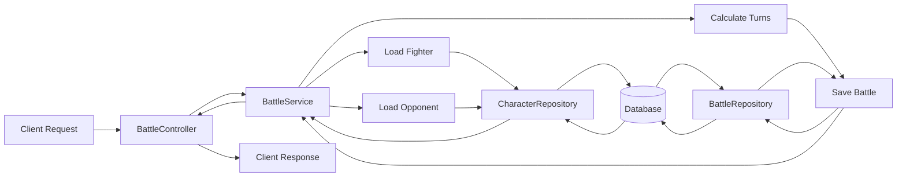
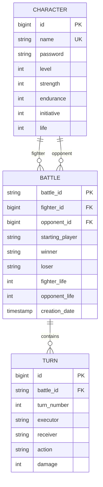

# Creeds API Flow Diagrams

This document contains detailed flow diagrams for the Creeds Game API.

## Character Creation Flow

## Battle Execution Flow

## Battle Turn Logic Flow

## Character Login Flow

## System Architecture

## Data Flow - Battle Execution

## Entity Relationships

## How to Render These Diagrams

### Online Tools
- [Mermaid Live Editor](https://mermaid.live/)
- [GitHub](https://github.com) - Automatically renders Mermaid diagrams in markdown files

### VS Code Extension
- Install "Markdown Preview Mermaid Support" extension
- Open this file and use the preview pane

### Documentation Tools
- [GitBook](https://www.gitbook.com/) - Supports Mermaid
- [Confluence](https://www.atlassian.com/software/confluence) - With Mermaid plugin
- [Notion](https://www.notion.so/) - Supports Mermaid blocks

